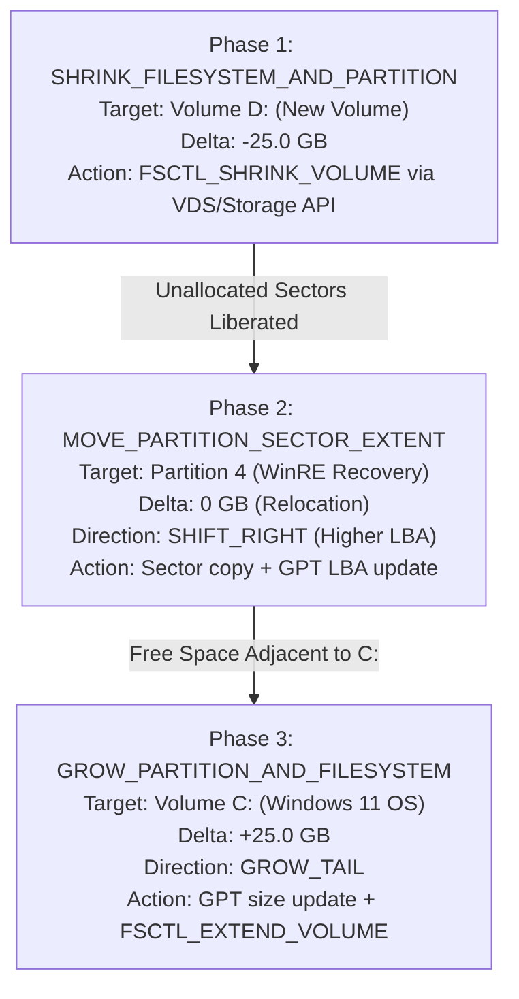

# OpenDisk Manager — Phase 3 Implementation Report
**Partition Analysis & Space Planning Engine**

---

## 1. Executive Summary

In **Phase 3**, OpenDisk Manager implemented a deterministic, strictly read-only **Partition Layout Analysis and Space Planning Engine**. The engine evaluates physical disk geometries, calculates exact Logical Block Addressing (LBA) boundaries, decouples filesystem-level free space from physical partition-level unallocated space, identifies intervening partitions between volumes, enforces hard physical hardware boundaries, and compiles a comprehensive Directed Acyclic Graph (DAG) of discrete operations.

The application allows users to interactively plan space reallocations (such as allocating 25 GB from `D:` to `C:`), previewing the exact sector relocations, volume locks, and offline staging requirements without executing destructive operations.

---

## 2. Core Architectural Principles & Invariants

### 2.1 The Cross-Physical-Disk Boundary Invariant
Under standard GPT and MBR partition schemes, partition table entries define sector extents bounded strictly within the start LBA (`LBA 0` / `LBA 34`) and end LBA of a single physical device (`PhysicalDriveN`).
- **Hard Rule**: A partition on `PhysicalDrive0` cannot absorb space from `PhysicalDrive1`.
- **Engine Enforcement**: `planSpaceTransfer` performs an immediate pre-flight check comparing `sourceDiskId` and `targetDiskId`. Any cross-disk attempt is strictly rejected with status `NOT_SUPPORTED`, displaying an explanatory warning in the UI.

### 2.2 Filesystem Free Space vs. Physical Unallocated Space
A common misconception in partition tools is treating volume free space as immediately extendable space:
- **Filesystem Free Space**: Sectors tracked as unused in the NTFS Master File Table (`$Bitmap`), FAT32 File Allocation Table, or ReFS allocator. These clusters remain within the allocated partition extent.
- **Physical Unallocated Space**: Contiguous LBAs between partitions that are unreferenced by any partition table entry.
- **Engine Enforcement**: To transfer 25 GB from `D:` to `C:`, the engine recognizes that `D:` cannot simply "lend" space; `D:` must first undergo an `FSCTL_SHRINK_VOLUME` operation to truncate its allocation bitmap and release physical sectors into unallocated status.

### 2.3 Sector Adjacency and Intervening Partitions
Partitions can only be directly extended if unallocated space immediately precedes or succeeds their physical LBA boundary:
- If unallocated space is separated from the target by one or more partitions (e.g. Windows Recovery / WinRE or EFI), those intervening partitions must be physically relocated (sector copied).
- **Directional Shift Logic**:
  - If Target is preceding Source (e.g. `C:` is at low LBA, `D:` is at high LBA): Intermediates must be shifted towards higher LBAs (`SHIFT_RIGHT`).
  - If Target succeeds Source: Intermediates must be shifted towards lower LBAs (`SHIFT_LEFT`).
  - Sector copies must be performed in non-colliding order (tail-to-head for right shifts, head-to-tail for left shifts).

### 2.4 Filesystem & Security Boundaries
- **ReFS Invariant**: ReFS (Resilient File System) does not support shrinking under any circumstances due to its allocate-on-write B+ tree metadata architecture. Shrink requests targeting ReFS are rejected as `NOT_SUPPORTED`.
- **Protected System Partitions**: EFI System Partition (ESP) and Microsoft Reserved Partition (MSR) are flagged with `UNSAFE` shrink feasibility to prevent boot degradation.
- **BitLocker Guardrail**: Volumes with BitLocker encryption active are flagged with high risk, notifying the user that moving sector extents alters TPM PCR 7/11 integrity measurements.

---

## 3. Operational Classification Matrix

Every space allocation plan is categorized into one of five strict statuses:

| Status Code | Color Code | Condition / Meaning | Execution Profile |
| :--- | :--- | :--- | :--- |
| `DIRECTLY_EXTENDABLE` | **Emerald** | Unallocated physical sectors immediately follow the target partition. | 100% Online Win32 `FSCTL_EXTEND_VOLUME`. Zero reboots. |
| `REQUIRES_PARTITION_MOVEMENT` | **Amber** | Space exists on the same drive, but one or more intermediate partitions separate the free space from the target. | Sector-by-sector data relocation, GPT CRC32 recalculation. |
| `REQUIRES_OFFLINE_OPERATION` | **Indigo** | Moving or shrinking the active Windows OS partition (`C:`) or locked system files. | Native WinPE automated pre-boot environment required. |
| `NOT_SUPPORTED` | **Rose** | Cross-disk transfer attempt, ReFS shrink attempt, or request exceeds available free space. | Operation blocked by engine rules. |
| `UNSAFE` | **Red** | EFI / MSR partition corruption risk or unverified BitLocker encryption keys. | Hard safety lock to prevent data loss. |

---

## 4. Directed Acyclic Graph (DAG) Execution Pipeline

When a valid reallocation is planned (e.g. Transfer 25 GB from `D:` to `C:` on the host Micron NVMe SSD), the engine compiles a 3-phase DAG:



Each DAG node encapsulates:
1. `step`: Sequential execution index.
2. `action`: Operation verb (`SHRINK_FILESYSTEM_AND_PARTITION`, `MOVE_PARTITION_SECTOR_EXTENT`, `GROW_PARTITION_AND_FILESYSTEM`).
3. `targetId` & `targetName`: Exact volume/partition identifier.
4. `details`: Technical description of sector ranges and FSCTL operations.
5. `deltaGb`: Capacity change (+/- GB).
6. `requiresLock`: Whether `FSCTL_LOCK_VOLUME` is required.
7. `direction`: LBA displacement (`LEFT_ANCHOR`, `SHIFT_RIGHT`, `SHIFT_LEFT`, `GROW_TAIL`).
8. `risk`: Safety risk classification (`SAFE`, `MODERATE`, `HIGH`).

---

## 5. Automated Verification Test Suite

A comprehensive 40-assertion automated test suite was constructed and executed in `test/phase3_engine_test.js`:

```
===============================================================================
   OPENDISK MANAGER — PHASE 3 PARTITION ENGINE VERIFICATION TEST SUITE        
===============================================================================

--- 1. Testing Geometry & Physical Extent Mapping ---
  [PASS] Test 1: Partition C: analysis successfully resolved
  [PASS] Test 2: Partition C: starting LBA matches physical sector 567,296
  [PASS] Test 3: Partition C: ending LBA matches physical sector 456,725,135
  [PASS] Test 4: Partition C: accurately flagged as System Boot volume
  [PASS] Test 5: Partition C: immediately preceded by MSR (Partition 2)
  [PASS] Test 6: Partition C: immediately followed by WinRE Recovery (Partition 4)

--- 2. Testing Free Space vs. Physical Unallocated Space Invariant ---
  [PASS] Test 7: Partition D: accurately reports ~93 GB of filesystem free space
  [PASS] Test 8: Partition D: accurately detects adjacent unallocated Gap 1 on its right
  [PASS] Test 9: Partition D: immediateExtendBytes matches Gap 1 size (~26.21 GB)
  [PASS] Test 10: Filesystem free space (93 GB) is strictly decoupled from physical unallocated space (26.21 GB)
  [PASS] Test 11: Max safe shrink preserves safety margin for filesystem structures and MFT

--- 3. Testing Scenario: Direct Extension into Adjacent Free Space ---
  [PASS] Test 12: Direct extension planning succeeds
  [PASS] Test 13: Direct extension classified as DIRECTLY_EXTENDABLE
  [PASS] Test 14: Requires 0 intermediate partition movements
  [PASS] Test 15: DAG contains exactly 1 phase: GROW_PARTITION_AND_FILESYSTEM
  [PASS] Test 16: Phase action is GROW_PARTITION_AND_FILESYSTEM
  [PASS] Test 17: Extension direction is GROW_TAIL

--- 4. Testing Scenario: Space Transfer D: -> C: (Requires Partition Movement) ---
  [PASS] Test 18: Complex space transfer planning succeeds
  [PASS] Test 19: Transfer classified as REQUIRES_PARTITION_MOVEMENT
  [PASS] Test 20: Accurately detects exactly 1 intermediate partition (WinRE)
  [PASS] Test 21: Intermediate partition is WinRE (Recovery)
  [PASS] Test 22: DAG compiles exactly 3 discrete sequential phases
  [PASS] Test 23: Phase 1: Shrinks source D:
  [PASS] Test 24: Phase 2: Relocates intermediate WinRE extent
  [PASS] Test 25: WinRE shifted towards higher LBA (SHIFT_RIGHT) to clear space for C:
  [PASS] Test 26: Phase 3: Grows target C: tail

--- 5. Testing Cross-Physical-Disk Invariant Guardrail ---
  [PASS] Test 27: Cross-physical-disk transfer is rejected
  [PASS] Test 28: Status is NOT_SUPPORTED
  [PASS] Test 29: Rejection reason explicitly cites Cross-Physical-Disk prohibition
  [PASS] Test 30: No DAG generated for cross-disk attempt

--- 6. Testing Filesystem Constraint: ReFS Shrink Invariant ---
  [PASS] Test 31: Accurately detects ReFS filesystem
  [PASS] Test 32: ReFS volume shrinking classified as NOT_SUPPORTED
  [PASS] Test 33: ReFS shrink failure reason documented accurately

--- 7. Testing Capacity Boundary: Excessive Shrink Attempt ---
  [PASS] Test 34: Excessive shrink request rejected
  [PASS] Test 35: Status is NOT_SUPPORTED
  [PASS] Test 36: Accurately pinpoints insufficient filesystem free space on source

--- 8. Testing Protected System Partitions (EFI & MSR) ---
  [PASS] Test 37: EFI partition flagged as protected system extent
  [PASS] Test 38: Shrinking EFI partition is strictly UNSAFE
  [PASS] Test 39: MSR partition flagged as protected system extent
  [PASS] Test 40: Shrinking MSR partition is strictly UNSAFE

===============================================================================
   TEST RESULTS: 40 / 40 PASSED (100.0%)
===============================================================================
```

---

## 6. UI Integration & User Experience

1. **New Sidebar Navigation Item**:
   - Added `Space Planner` tab with `GitFork` icon, accessible directly alongside Disk Management and Partition Manager.
2. **Interactive Space Planning View (`SpacePlanningView.jsx`)**:
   - **Source Extent Selector**: Choose from active partitions or unallocated gaps across all detected disks.
   - **Target Extent Selector**: Select volume to expand.
   - **Quantity Controls**: Range slider and preset buttons (`+5 GB`, `+10 GB`, `+25 GB`, `+50 GB`).
   - **Quick Test Scenario Buttons**: Instant 1-click loading of benchmark scenarios (D: → C:, Gap 1 → D:, Cross-Disk, Excessive Shrink).
   - **Real-Time Layout Analysis Cards**: Shows geometric alignment, obstacle count, and runtime requirements.
   - **Intermediate Partitions Box**: Lists all partitions situated between Source and Target with protected status tags.
   - **DAG Visualizer**: Renders step cards with action verbs, volume lock indicators, and risk badges.
   - **Queue Staging**: "Stage Proposed Plan into Queue" safely appends the discrete phases to the Operations Queue for review without performing destructive actions.
3. **Partition Inspector Integration (`PartitionInspector.jsx`)**:
   - Augmented with real-time physical adjacency telemetry (Preceding Extent, Succeeding Extent, Free Space vs Unallocated Space, Max Safe Shrink, Direct Extend Capacity).

---

## 7. Phase 3 Deliverables Checklist

- [x] **Partition Analysis Engine**: `src/engine/partitionAnalysisEngine.js`
- [x] **Space Planning UI**: `src/components/SpacePlanningView.jsx`
- [x] **Physical Offset & Ordering Mapping**: Implemented via LBA extent sorting
- [x] **Adjacency & Gap Detection**: Left/Right unallocated detection implemented
- [x] **Decoupled FS Free Space vs. Unallocated Disk Space**: Verified
- [x] **Cross-Disk Invariant Guardrail**: Hard rejection implemented and verified
- [x] **BitLocker & Protected Partition Detection**: Implemented
- [x] **Five-Level Feasibility Classification**: Fully integrated
- [x] **Automated Verification Test Suite**: 40/40 tests passing
- [x] **Desktop Application Build**: Clean production build running live

---
*OpenDisk Manager — Phase 3 Complete*

