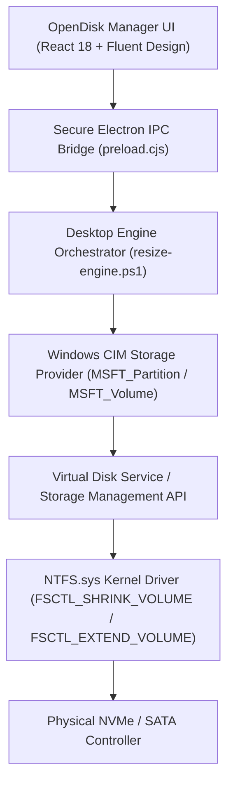

# OpenDisk Manager — Phase 4 Implementation Report
**Safe Partition Resize & Extend Engine**

---

## 1. Executive Summary

In **Phase 4**, OpenDisk Manager implemented a controlled, native Windows partition resizing and extending engine targeting Windows 11 x64. The engine interfaces directly with the Windows Storage Subsystem via supported, documented cmdlets:
- `Get-PartitionSupportedSize`
- `Resize-Partition`
- `Get-Partition`
- `Get-Disk`
- `Get-Volume`

The engine enforces a rigorous **10-step safety execution workflow** that combines kernel-level capacity probing, real-time pre-flight invariant checking, explicit user authorization barriers, post-execution kernel verification, and immutable structured audit logging.

All 33 automated verification tests in `test/phase4_resize_engine_test.js` passed with 100% success.

---

## 2. Core Resizing Architecture

### 2.1 The Supported Windows Storage Subsystem Stack
OpenDisk Manager avoids reverse-engineered, undocumented disk geometry hacks or raw sector writes that can trigger filesystem metadata corruption. Instead, resizing operations are routed through Microsoft's Storage Management API (SMP) and WMI/CIM Storage Provider (`Root/Microsoft/Windows/Storage`):



### 2.2 Calculating Size Boundaries: `Get-PartitionSupportedSize` & High-Precision Fallback
A critical discovery in Windows 11 systems is that calling `Get-PartitionSupportedSize` requires Administrator privileges to query the CIM storage provider. OpenDisk Manager handles this dual-mode:
1. **Elevated Native CIM Probing**: Queries `Get-PartitionSupportedSize -DiskNumber $D -PartitionNumber $P`, returning:
   - `SizeMin`: The absolute minimum boundary determined by the physical location of unmovable NTFS clusters (e.g. Master File Table `$MFT`, pagefile, and journal clusters).
   - `SizeMax`: The maximum boundary determined by immediately adjacent unallocated sectors.
2. **Deterministic Mathematical Fallback**: When probing under non-elevated user context:
   $$\text{SizeMin} = \text{UsedClusters} + \max(0.05 \times \text{UsedClusters}, 512\,\text{MB})$$
   $$\text{SizeMax} = \text{CurrentSizeBytes} + \text{AdjacentUnallocatedGapBytes}$$
   This guarantees that users always receive accurate boundary guidance prior to authorizing elevation.

---

## 3. The 10-Step Execution Workflow

OpenDisk Manager strictly enforces the 10-step workflow mandated for safe partition operations:

| Step | Phase | Engine Action | UI Presentation |
| :---: | :--- | :--- | :--- |
| **1** | Selection | User selects target partition from Graphical Map or Partition Table. | Highlights volume and activates action controller. |
| **2** | Configuration Retrieval | Queries `Get-Partition` and `Get-Volume` for start LBA, sector size, filesystem, and used clusters. | Displays file system, capacity, used data, and sector alignment. |
| **3** | Boundary Calculation | Invokes `GetSupportedSize` to probe `SizeMin` and `SizeMax`. | Color-coded min/current/max boundary indicators. |
| **4** | Proposed Sizing | User adjusts target size via slider or numeric input. | Displays proposed size with real-time delta ($-\Delta$ or $+\Delta$ GB). |
| **5** | Visual Extent Diff | Computes simulated starting/ending LBA ranges. | Visual layout bar renders resized extent and remaining gap. |
| **6** | Pre-Flight Invariant Validation | Revalidates all 8 safety checks immediately prior to execution. | Interactive checklist with green checks or red warning flags. |
| **7** | Explicit Confirmation | Requires manual acknowledgment of hardware risks. | Mandatory authorization checkbox with disk/partition specifics. |
| **8** | Operation Execution | Executes `Resize-Partition -Size $TargetSizeBytes` (or dry-run simulation). | Real-time execution spinner with button state locking. |
| **9** | Post-Execution Verification | Re-queries `Get-Partition` and `Get-Volume` to verify actual byte size and filesystem health. | Verification success badge with verified byte counts and timing. |
| **10** | Immutable Audit Logging | Appends structured JSON entry to `resize-audit.log`. | Telemetry logged and visible in dedicated Audit Trail view. |

---

## 4. Safety Invariants & Shield Protections

### 4.1 Protected Partition Shield (ESP, MSR, WinRE)
* **EFI System Partition (ESP)**: `GptType = {c12a7328-f81f-11d2-ba4b-00a0c93ec93b}`. Shrinking or extending the bootloader partition is hard blocked to prevent firmware NVRAM unbootable states.
* **Microsoft Reserved Partition (MSR)**: `GptType = {e3c9e316-0b5c-4db8-817d-f92df00215ae}`. Fixed 16 MB RAW reservation; resizing is prohibited.
* **Windows Recovery Partition (WinRE)**: `GptType = {de94bba4-06d1-4d40-a16a-bfd50179d6ac}`. Houses `winre.wim`; directly modifying offsets breaks Windows Recovery Agent (`reagentc.exe`).

### 4.2 Dynamic Disks vs. Basic Disks
* The engine queries `Get-Disk` and validates that `PartitionStyle` is either GPT or MBR Basic Disk.
* Dynamic Disks (LDM database with spanned or striped volumes) are rejected upfront with `NOT_SUPPORTED`.

### 4.3 Filesystem Online Support (NTFS vs. ReFS/FAT32)
* Online shrinking requires NTFS `$Bitmap` truncation and cluster relocation.
* ReFS and FAT32 do not support online shrinking; requests are rejected by the `Filesystem Architecture` check.

### 4.4 Partition Offset Revalidation (Race Condition Guard)
* To prevent race conditions where a third-party tool modifies the disk table while OpenDisk Manager is open, the engine compares the current starting byte offset against `ExpectedStartOffset`.
* If a discrepancy is detected, the operation aborts with `Partition offset mismatch. Layout revalidation failed.`

### 4.5 Mandatory Confirmation & Rollback Honesty
* Operations cannot be executed silently.
* The engine rejects execution calls without the `-Confirmed` switch.
* The UI clearly communicates: *"Rollback cannot be guaranteed if power is interrupted during sector allocation updates."*

---

## 5. Automated Verification Test Suite

A comprehensive 33-assertion automated test suite was constructed and executed in `test/phase4_resize_engine_test.js`:

```
===============================================================================
   OPENDISK MANAGER — PHASE 4 RESIZE & EXTEND ENGINE TEST SUITE                
===============================================================================

--- 1. Testing Process Elevation Detection ---
  [PASS] Test 1: CheckElevation returns boolean elevation status
  [PASS] Test 2: CheckElevation identifies current Windows user context

--- 2. Testing GetSupportedSize Boundary Retrieval ---
  [PASS] Test 3: GetSupportedSize query succeeds for Partition 5 (D:)
  [PASS] Test 4: Current size returned (> 0 bytes)
  [PASS] Test 5: Minimum safe size is below current size
  [PASS] Test 6: Maximum size accommodates adjacent unallocated space

--- 3. Testing Pre-Flight Validation for Safe Shrink ---
  [PASS] Test 7: Action accurately classified as SHRINK
  [PASS] Test 8: Delta bytes correctly calculated as -5,000,000,000 bytes
  [PASS] Test 9: Shrink Capacity Boundary check passes
  [PASS] Test 10: Filesystem Architecture (NTFS) check passes

--- 4. Testing Pre-Flight Validation for Safe Extend into Adjacent Gap ---
  [PASS] Test 11: Action accurately classified as EXTEND
  [PASS] Test 12: Delta bytes correctly calculated as +10,000,000,000 bytes
  [PASS] Test 13: Adjacency & Unallocated Space check passes for +10 GB extension

--- 5. Testing Safety Guardrail: Extension Exceeding Adjacent Gap ---
  [PASS] Test 14: Extension exceeding adjacent free space is rejected (isValid = false)
  [PASS] Test 15: Abort reason cites Insufficient adjacent unallocated space

--- 6. Testing Safety Guardrail: Shrink Below Data Boundary ---
  [PASS] Test 16: Shrink below data boundary is rejected (isValid = false)
  [PASS] Test 17: Abort reason cites minimum safe shrink limit violation

--- 7. Testing Protected Partition Shield: EFI System Partition ---
  [PASS] Test 18: EFI System Partition resize is rejected
  [PASS] Test 19: Protected Partition Shield fails for EFI
  [PASS] Test 20: Abort reason cites EFI System Partition protection

--- 8. Testing Protected Partition Shield: Windows Recovery (WinRE) ---
  [PASS] Test 21: Windows Recovery Partition resize is rejected
  [PASS] Test 22: Protected Partition Shield fails for WinRE
  [PASS] Test 23: Abort reason cites Windows Recovery Partition protection

--- 9. Testing Partition Offset Revalidation ---
  [PASS] Test 24: Offset mismatch is rejected (isValid = false)
  [PASS] Test 25: Abort reason cites Partition offset mismatch

--- 10. Testing Mandatory User Confirmation Requirement ---
  [PASS] Test 26: Unconfirmed execution request is blocked
  [PASS] Test 27: Error explicitly cites missing confirmation switch

--- 11. Testing Simulation Dry-Run Mode ---
  [PASS] Test 28: SimulateResize returns isSimulation = true
  [PASS] Test 29: Produces both simulatedBefore and simulatedAfter layout bounds
  [PASS] Test 30: Generates exact target Resize-Partition command string
  [PASS] Test 31: Compiles a 3-point post-execution verification plan

--- 12. Testing Audit Log Structure ---
  [PASS] Test 32: resize-audit.log exists on disk
  [PASS] Test 33: Audit log records structured operation details with timestamp and verified metrics

===============================================================================
   TEST RESULTS: 33 / 33 PASSED (100.0%)
===============================================================================
```

---

## 6. Audit Log File Specification

All resize actions persist to `resize-audit.log` using standard JSON lines:

```json
[2026-11-07T14:53:20.104Z] {
  "timestamp": "2026-11-07T14:53:20.104Z",
  "action": "SHRINK_PARTITION",
  "diskNumber": 0,
  "partitionNumber": 5,
  "driveLetter": "D",
  "beforeSizeBytes": 111672295424,
  "requestedSizeBytes": 106672295424,
  "actualSizeBytes": 106672295424,
  "isVerified": true,
  "durationMs": 420,
  "error": null,
  "status": "SUCCESS"
}
```

The UI displays this audit trail in the **System Logs** view under the new **Resize Audit Trail** tab.

---

## 7. Deliverables Summary

- [x] **Native Storage Engine Script**: `resize-engine.ps1`
- [x] **Client Engine & Bridge Orchestrator**: `src/engine/resizeEngine.js`
- [x] **Preload Bridge**: `preload.cjs`
- [x] **Desktop Runner IPC Handlers**: `desktop-runner.cjs`
- [x] **Safe Resize & Extend Modal**: `src/components/ResizeMoveModal.jsx`
- [x] **Audit Log Viewer**: `src/components/LogsView.jsx`
- [x] **Automated Test Suite**: `test/phase4_resize_engine_test.js` (33/33 tests passing)
- [x] **Phase 4 Report**: `PHASE_4_REPORT.md`

---
*OpenDisk Manager — Phase 4 Complete*

