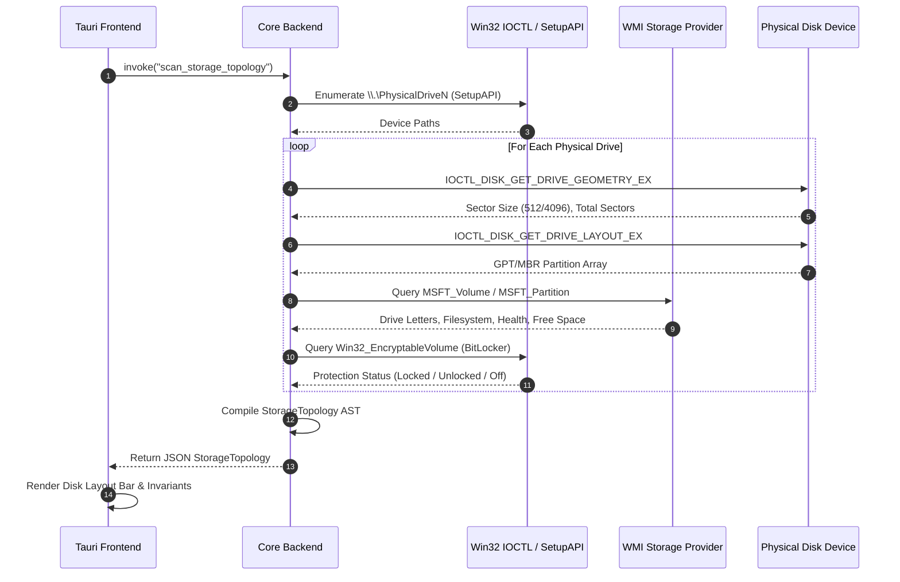
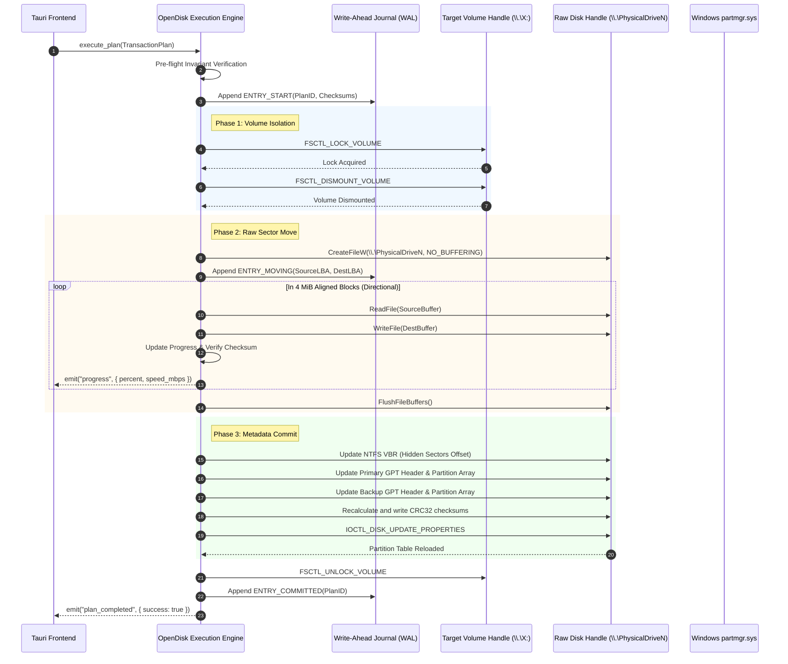

# OpenDisk Manager — System Architecture Specification

**Document Version:** 1.0.0  
**Target Platform:** Windows 11 x64 (Build 22000+)  
**Architecture:** Tauri v2 + Rust Core + Modern Web UI (TypeScript)  
**Security Context:** Elevated Administrator (`requireAdministrator`, `SeManageVolumePrivilege`)

---

## 1. Executive Summary & Vision

OpenDisk Manager is an open-source, high-reliability Windows disk and partition management suite engineered specifically for modern Windows 11 x64 systems. Unlike legacy tools (such as Windows Disk Management `diskmgmt.msc`) that cannot move partitions or extend volumes when unallocated space is non-contiguous, OpenDisk Manager bridges the gap between user-mode GUI convenience and low-level storage engineering.

The application adheres to a strict safety-first architectural model:
- **Decoupled Architecture**: High-speed, memory-safe Rust backend communicating via strongly typed IPC with an ergonomic web-based presentation layer.
- **Two-Tier Engine Model**: Native Windows Storage API & Win32 IOCTL integration for standard online operations, complemented by an autonomous raw sector block mover engine and a dedicated Windows PE (WinPE) staging environment for offline system-volume operations.
- **Non-Destructive Invariant**: Zero writes to disk without explicit pre-flight verification, transaction journaling, and user validation of visual layout diffs.

---

## 2. High-Level System Architecture

OpenDisk Manager is organized into four distinct operational tiers:

```
+--------------------------------------------------------------------------+
|                         Presentation Layer (UI)                          |
|   HTML5 / CSS3 / TypeScript (React + Tailwind CSS + Lucide Icons)        |
|  - Disk/Partition Visualizer       - Pending Operations Queue            |
|  - Visual Layout Diff Preview       - Safety Guardrails & Modal Dialogs   |
+------------------------------------+-------------------------------------+
                                     |
                          Typed Tauri IPC Bridge
               (Serde JSON, Command Invocation, Progress Events)
                                     |
+------------------------------------+-------------------------------------+
|                     OpenDisk Core Backend (Rust)                         |
|                                                                          |
|  +------------------------+  +----------------------------------------+  |
|  | Inspection Engine      |  | Transaction Planner & Validator        |  |
|  | - Win32 IOCTL Scanner  |  | - Layout Graph Builder                 |  |
|  | - WMI/CIM Storage Query|  | - Invariant & Safety Verifier          |  |
|  | - Volume & FS Profiler |  | - Two-Phase Commit Journal             |  |
|  +------------------------+  +----------------------------------------+  |
|                                                                          |
|  +--------------------------------------------------------------------+  |
|  | Execution Engine Subsystems                                        |  |
|  |  +-----------------------+  +------------------------------------+  |  |
|  |  | Native Win32 Engine   |  | Raw Block Mover Engine             |  |  |
|  |  | - SMAPI / VDS / IOCTL |  | - Bidirectional Sector Copier      |  |  |
|  |  | - Online Extend/Shrink|  | - CRC32 Rolling Verifier           |  |  |
|  |  | - Create/Delete/Format|  | - Sector-Aligned I/O Buffer        |  |  |
|  |  +-----------------------+  +------------------------------------+  |  |
|  |  +---------------------------------------------------------------+  |  |
|  |  | Offline / WinPE Companion Subsystem                           |  |  |
|  |  | - Windows RE Hook / ISO Builder                               |  |  |
|  |  | - Autonomous Boot Staging for Active System Disk (C:)          |  |  |
|  |  +---------------------------------------------------------------+  |  |
|  +--------------------------------------------------------------------+  |
+------------------------------------+-------------------------------------+
                                     |
                 Native Windows Kernel & Storage Interfaces
                                     |
+------------------------------------+-------------------------------------+
|                      Windows 11 Storage Stack                            |
|  - Direct Device Handles: \\.\PhysicalDriveN, \\.\Volume{GUID}            |
|  - Storage IOCTLs: IOCTL_DISK_*, FSCTL_LOCK_VOLUME, FSCTL_SHRINK_VOLUME   |
|  - Storage Class Drivers: disk.sys, partmgr.sys, volmgr.sys               |
|  - Security & Encryption: fvevol.sys (BitLocker), VSS (Volume Snapshot)   |
+--------------------------------------------------------------------------+
```

---

## 3. Core Component Breakdown

### 3.1. Presentation Layer (Tauri Frontend)
- **Framework**: Tauri v2 paired with React 18 and TypeScript.
- **State Management**: Zustand for transactional operation queuing and real-time disk state caching.
- **Visualization Engine**:
  - Proportional SVG/Canvas partition map depicting exact physical disk layout.
  - Distinct color coding for GPT partition types (ESP, MSR, Basic Data, Recovery, Unallocated).
  - High-precision partition resizing sliders with input snapping to cylinder/1 MiB boundaries.
  - Interactive "Before vs After" execution preview modal highlighting affected sector ranges.
- **Telemetry & Logs**: Real-time streaming log viewer displaying byte-level copy progress, throughput (MB/s), estimated time remaining (ETA), and I/O status.

### 3.2. Tauri IPC & Privilege Layer
- **Elevation Requirement**: OpenDisk Manager cannot operate in standard user context. The application binary embeds an execution level manifest:
  ```xml
  <security>
    <requestedPrivileges>
      <requestedExecutionLevel level="requireAdministrator" uiAccess="false" />
    </requestedPrivileges>
  </security>
  ```
- **Privilege Adjustment**: On startup, the Rust backend explicitly adjusts token privileges via `AdjustTokenPrivileges` to enable:
  - `SeManageVolumePrivilege` (Required for volume extension, defragmentation, and shrink queries)
  - `SeBackupPrivilege` and `SeRestorePrivilege` (Required for raw volume locking and low-level I/O)
  - `SeShutdownPrivilege` (Required if offline WinPE reboot staging is invoked)

### 3.3. Disk & Volume Inspection Engine
The inspection subsystem combines direct Win32 IOCTL queries with WMI CIM Storage queries to build an authoritative, real-time in-memory disk layout graph:
1. **Physical Drive Enumeration**: Queries `SetupAPI` (`GUID_DEVINTERFACE_DISK`) and `CreateFileW` on `\\.\PhysicalDrive0..N`.
2. **Geometry & Layout Retrieval**:
   - `IOCTL_DISK_GET_DRIVE_GEOMETRY_EX` for total capacity, physical/logical sector sizes (512e vs 4Kn).
   - `IOCTL_DISK_GET_DRIVE_LAYOUT_EX` for raw partition table reading (MBR vs GPT structures, partition GUIDs, start/length offsets).
3. **Volume-to-Partition Association**:
   - Queries `FindFirstVolumeW` / `FindNextVolumeW`.
   - Maps volume paths (`\\?\Volume{GUID}`) to physical extents using `IOCTL_VOLUME_GET_VOLUME_DISK_EXTENTS`.
   - Detects mount points, drive letters, and filesystem labels.
4. **Filesystem Profiling**:
   - `GetDiskFreeSpaceExW` for filesystem-level free vs occupied clusters.
   - `FSCTL_GET_NTFS_VOLUME_DATA` for MFT location, cluster size, and total clusters.
   - BitLocker status inspection via WMI `root\CIMv2\Security\MicrosoftVolumeEncryption` (`Win32_EncryptableVolume`).

### 3.4. Transaction Planner & Safety Engine
OpenDisk Manager enforces transactional batching. Operations selected by the user are not executed immediately; they are compiled into a Directed Acyclic Graph (DAG) of discrete operations:
- **Operation Types**:
  - `CreatePartition(disk_id, start_lba, size_lba, type_guid)`
  - `DeletePartition(disk_id, partition_id)`
  - `FormatPartition(volume_id, fs_type, cluster_size, label)`
  - `OnlineExtendVolume(volume_id, new_size_bytes)`
  - `OnlineShrinkVolume(volume_id, new_size_bytes)`
  - `MovePartition(disk_id, partition_id, new_start_lba)`
- **Planner Validation Checks**:
  - Overlap validation: No partition sector range may overlap with another or encroach into reserved LBA zones (LBA 0–33 and Backup GPT at disk end).
  - 1 MiB (2048 sector) alignment verification on all target boundaries.
  - Free space verification: Destination sector range must consist purely of unallocated space.
  - Immutable partition protection: Blocks any modification to MSR or active BitLocker volumes without explicit user unlock.

### 3.5. Native Windows Execution Engine
For operations supported natively by the Windows Storage Stack:
- **Shrink Workflow (NTFS)**:
  1. Acquire handle to `\\.\X:` with `GENERIC_READ | GENERIC_WRITE`.
  2. Send `FSCTL_SHRINK_VOLUME` with desired target cluster count.
  3. Windows NTFS driver moves unmovable clusters within tolerance and truncates volume.
  4. Send `IOCTL_DISK_SET_DRIVE_LAYOUT_EX` to shrink the GPT/MBR partition boundary to match the new volume size.
- **Extend Workflow (NTFS/ReFS)**:
  1. Send `IOCTL_DISK_SET_DRIVE_LAYOUT_EX` to expand the GPT/MBR partition boundary into adjacent trailing unallocated space.
  2. Send `FSCTL_EXTEND_VOLUME` with the new size.
  3. Windows filesystem driver extends internal allocation bitmaps (`$Bitmap`).

### 3.6. Raw Block Mover Engine
For operations unsupported by Windows APIs (moving a partition start offset left or right):
- **Mechanism**: Low-level sector-by-sector copying on locked raw drive handles.
- **Locking Protocol**:
  1. Send `FSCTL_LOCK_VOLUME` to all volumes on the partition. If locked, send `FSCTL_DISMOUNT_VOLUME`.
  2. Open handle to `\\.\PhysicalDriveN` with `FILE_FLAG_NO_BUFFERING | FILE_FLAG_WRITE_THROUGH`.
  3. Determine copy direction:
     - **Moving Right** ($LBA_{dest} > LBA_{src}$): Copy backward from end of partition to beginning.
     - **Moving Left** ($LBA_{dest} < LBA_{src}$): Copy forward from beginning of partition to end.
  4. Transfer data in aligned 4 MiB chunks.
  5. Recalculate CRC32 of copied sectors using parallel SIMD hashing.
  6. Update GPT Partition Entry (Start LBA, End LBA) and write updated Primary + Backup GPT headers.
  7. Patch Filesystem Volume Boot Record ($VBR$) hidden sectors offset.
  8. Send `IOCTL_DISK_UPDATE_PROPERTIES` to force `partmgr.sys` to re-read the partition table.

### 3.7. Offline / WinPE Companion Subsystem
When the active boot/system partition (`C:`) must be moved or shrunk beyond native online limits:
- The OS volume cannot be dismounted or locked while Windows is running.
- OpenDisk Manager stages an automated reboot into Windows Recovery Environment (WinPE/WinRE):
  1. Generates an automated execution script (`opendisk-task.json`) placed in `C:\Recovery\OpenDisk\`.
  2. Injects the standalone console worker binary (`opendisk-worker.exe`) into the WinRE scratch space or creates a temporary BCD boot entry pointing to a portable WinPE image.
  3. Sets one-time boot sequence via BCD API (`bcdedit /bootsequence {guid}`).
  4. Triggers controlled system restart. The offline worker executes the partition move with 100% exclusive raw drive access, updates BCD pointers, and reboots back into Windows 11.

---

## 4. Architectural Sequence Diagrams

### 4.1. Disk Inspection & Profiling Flow



### 4.2. Partition Move & Resize Execution Sequence



---

## 5. Module Structure (Rust Backend)

```
opendisk-core/
├── Cargo.toml
├── src/
│   ├── main.rs                   # Application entry, privilege checks, Tauri setup
│   ├── api/                      # Tauri IPC Command Handlers
│   │   ├── commands_disk.rs      # Enumerate, scan, refresh
│   │   ├── commands_ops.rs       # Plan validation, execution triggers
│   │   └── commands_safety.rs    # Invariant checking, BitLocker verification
│   ├── engine/                   # Core Partitioning Logic
│   │   ├── planner.rs            # Plan compiler, DAG scheduler, alignment calculator
│   │   ├── native_win32.rs       # SMAPI, FSCTL_SHRINK, FSCTL_EXTEND, Format
│   │   ├── block_mover.rs        # Low-level sector copier, overlap direction logic
│   │   ├── gpt_manager.rs        # Custom GPT header/array parser and CRC32 builder
│   │   ├── mbr_manager.rs        # MBR parser and CHS/LBA calculator
│   │   ├── journal.rs            # Write-Ahead Journal (WAL) crash recovery
│   │   └── winpe_stage.rs        # WinPE companion generator and BCD staging
│   ├── platform/                 # Windows-Specific Low-Level Interop
│   │   ├── ioctl.rs              # DeviceIoControl wrappers, CTL_CODE definitions
│   │   ├── handle.rs             # RAII handles for PhysicalDrive, Volume, Locks
│   │   ├── bitlocker.rs          # WMI BitLocker status inspector
│   │   ├── vss.rs                # VSS snapshot interaction and unmovable file detection
│   │   └── privileges.rs         # Token elevation and privilege manipulation
│   └── models/                   # Common Data Structures
│       ├── disk.rs               # Disk, Partition, Volume structs
│       ├── operations.rs         # PartitionOp, TransactionPlan, PlanStatus
│       └── errors.rs             # Strongly typed error hierarchy (DiskError)
```

---

## 6. Data Exchange Model (IPC Schema)

All communication between the Tauri frontend and Rust core uses strict JSON contracts.

### 6.1. Disk Topology Contract
```typescript
export interface StorageTopology {
  disks: PhysicalDisk[];
  scanTimestamp: string;
}

export interface PhysicalDisk {
  id: number;                     // e.g. 0 for PhysicalDrive0
  path: string;                   // \\.\PhysicalDrive0
  friendlyName: string;           // Samsung SSD 980 PRO 1TB
  busType: 'NVMe' | 'SATA' | 'USB' | 'SCSI' | 'Unknown';
  partitionStyle: 'GPT' | 'MBR' | 'RAW';
  totalSizeBytes: number;
  sectorSize: number;             // Logical sector size (e.g., 512 or 4096)
  physicalSectorSize: number;     // Physical sector size (e.g., 4096)
  isReadOnly: boolean;
  isSystemDisk: boolean;
  partitions: DiskPartition[];
  unallocatedSpaces: UnallocatedExtent[];
}

export interface DiskPartition {
  partitionNumber: number;
  diskId: number;
  startLba: number;
  endLba: number;
  totalSizeBytes: number;
  typeGuid: string;               // GPT Type GUID or MBR Type Byte
  partitionType: 'ESP' | 'MSR' | 'BasicData' | 'Recovery' | 'Unknown';
  uniqueGuid: string;
  volume: VolumeInfo | null;
  attributes: string[];           // ReadOnly, Hidden, PlatformRequired
  isBootOrSystem: boolean;
  isBitLockerEncrypted: boolean;
}

export interface VolumeInfo {
  driveLetter: string | null;     // e.g. "C:"
  volumeGuidPath: string;         // \\?\Volume{...}\
  fileSystem: 'NTFS' | 'FAT32' | 'exFAT' | 'ReFS' | 'RAW';
  label: string;
  totalSizeBytes: number;
  freeSizeBytes: number;
  clusterSizeBytes: number;
  supportedMinSizeBytes: number;  // Minimum safe shrink size reported by FSCTL
  supportedMaxSizeBytes: number;  // Maximum extend boundary based on free space
}
```

---

## 7. Verification & Safety Enforcements

The architecture strictly enforces three layers of safety gates before any byte is altered:

```
[User Action] 
     │
     ▼
[Safety Gate 1: Planning Validator]
 ├── Check partition alignment (1 MiB boundary)
 ├── Verify no overlap with adjacent partitions
 ├── Ensure immutable partitions (ESP, MSR) are untouched
 ├── Ensure target sector range has zero occupied extents
 └── Verify filesystem is supported for selected operation
     │
     ▼ Passed
[Safety Gate 2: Pre-Flight State Check]
 ├── Check disk S.M.A.R.T. health (abort if pending reallocations > 0)
 ├── Verify BitLocker protection state (abort if locked or active)
 ├── Acquire exclusive volume lock (FSCTL_LOCK_VOLUME)
 └── Verify target volumes can dismount cleanly
     │
     ▼ Passed
[Safety Gate 3: Write-Ahead Transaction Journal]
 ├── Flush original GPT / MBR sector states to journal file
 ├── Record intended source, destination, and block counts
 └── Mark journal state: IN_PROGRESS
     │
     ▼
[Execution of Operations]
```

---

## 8. Summary of Architectural Attributes

| Attribute | Specification | Rationale |
| :--- | :--- | :--- |
| **GUI Framework** | Tauri v2 (Rust + WebView2) | Minimal binary footprint (~15 MB), low memory overhead (<60 MB), high performance, native Windows look & feel via WebView2. |
| **Core Engine** | Rust (Native Win32 IOCTL + Custom Block Mover) | Memory safety, zero-cost concurrency for SIMD block hashing, direct low-level Win32 hardware control without garbage collection pauses. |
| **Data Safety** | Write-Ahead Journaling (WAL) + Pre-Flight Invariants | Absolute prevention of silent corruption, automatic rollback capabilities, and strict partition alignment. |
| **System Disk Strategy** | Autonomous WinPE / WinRE Companion Handoff | Eliminates bluescreen (BSOD) risks inherent to native NT `autocheck` drivers while enabling offline `C:` drive operations. |
